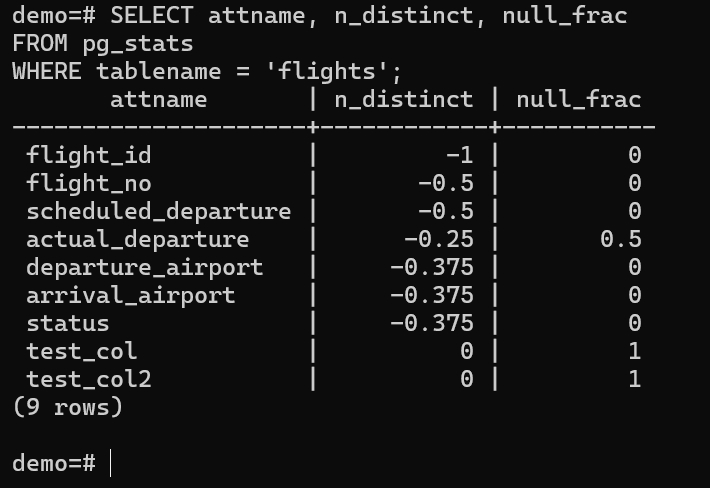
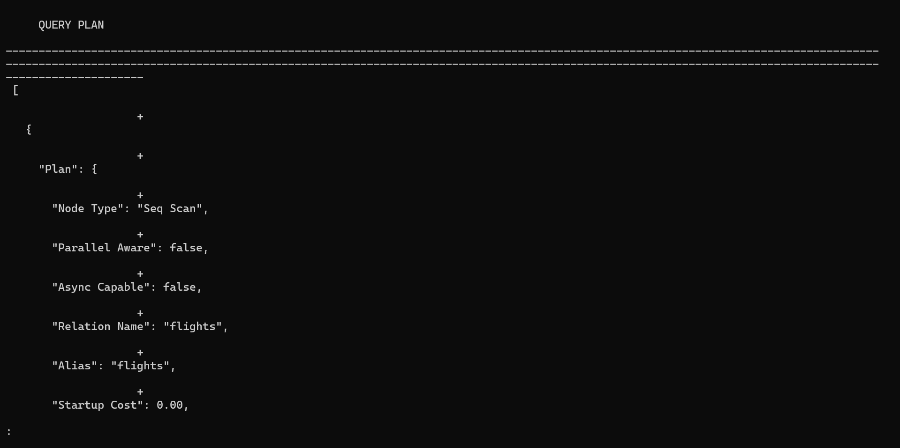
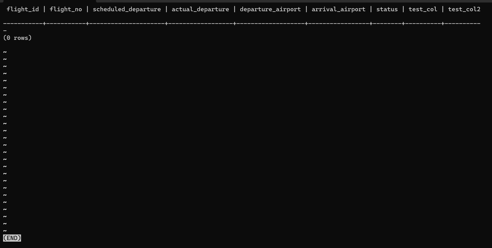
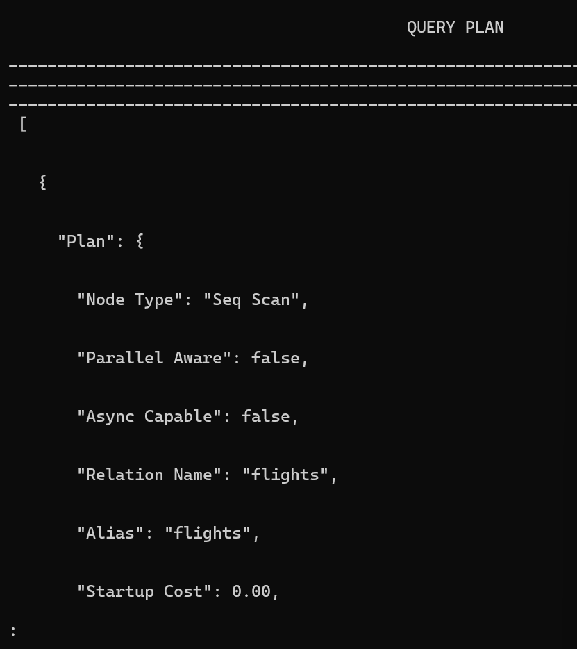
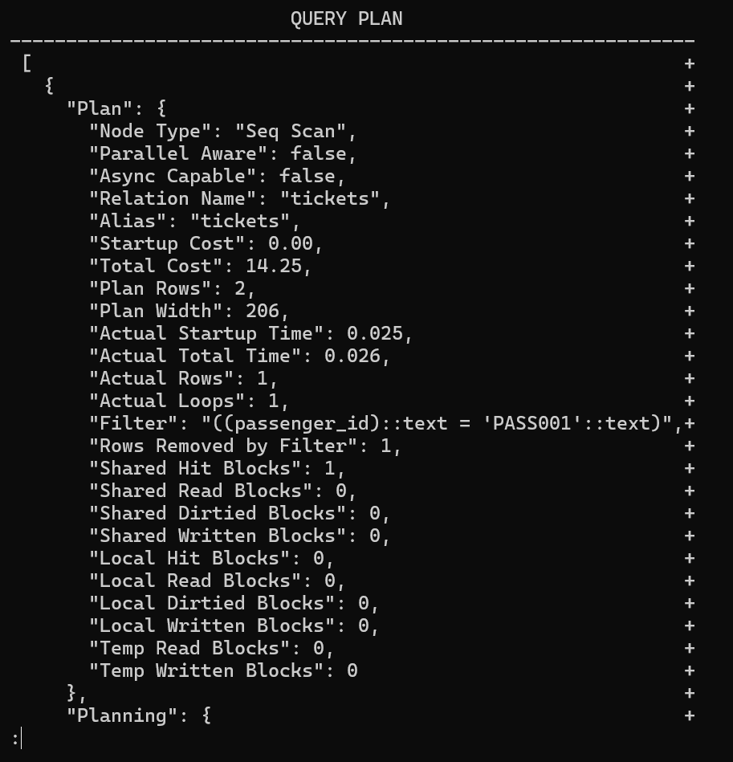
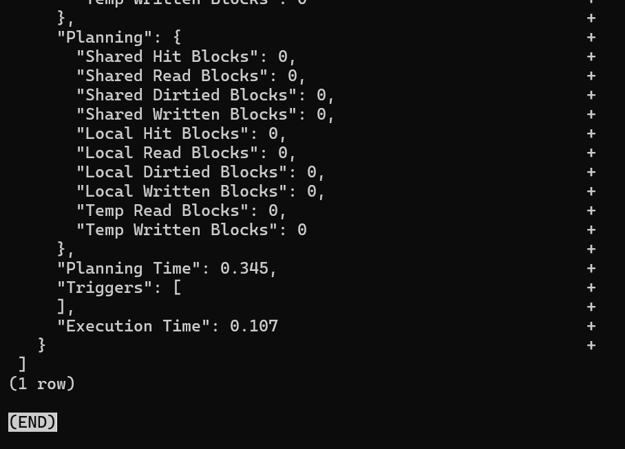
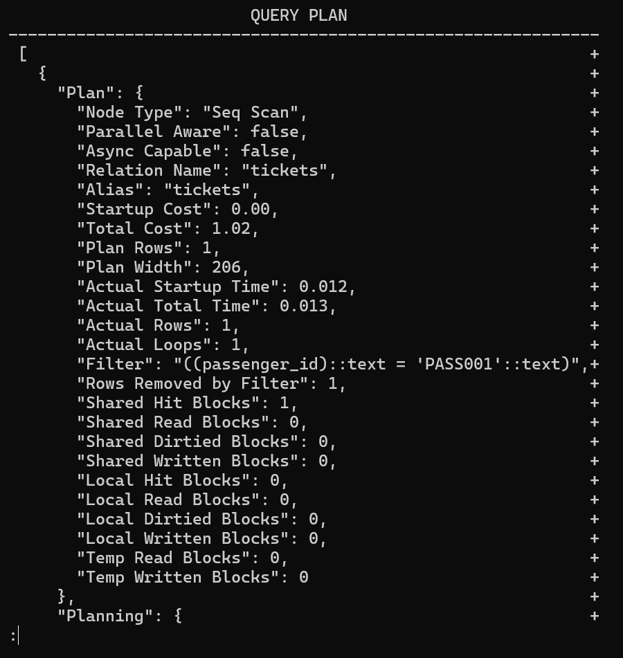
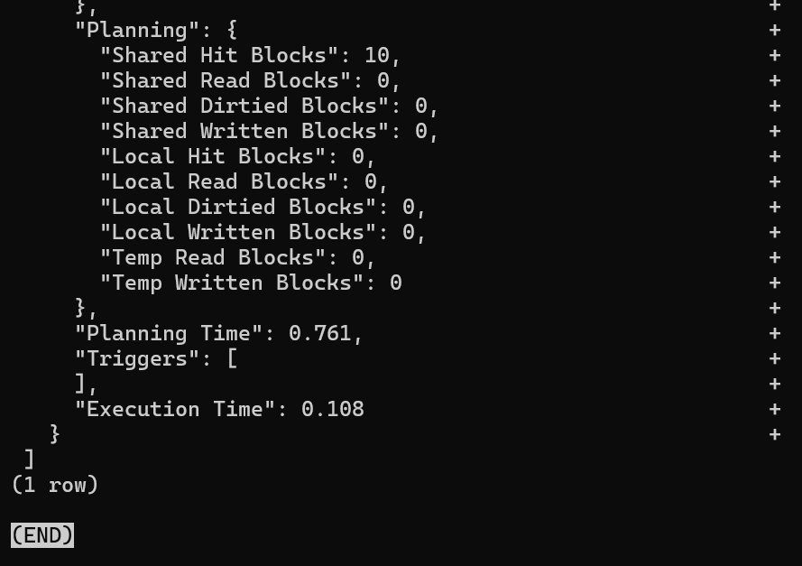

# Домашнее задание №6. Индексы в PostgreSQL

## 1. Исследование статистики (`pg_stats`)

**Скриншот статистики:**


**Анализ (на примере таблицы `flights`):**
1. `flight_id` — `n_distinct` = -1 (каждое значение уникально), `null_frac` = 0. Наибольшая кардинальность. Идеально подходит для начала составного индекса.
2. `status` — `n_distinct` = 3 (всего 3 статуса), `null_frac` = 0. Хорошая колонка для фильтрации, но из-за малого числа уникальных значений не подходит для начала индекса.
3. `actual_departure` — `n_distinct` = -1, но `null_frac` > 0 (есть пустые значения, так как рейсы могут быть отменены). Может использоваться в индексе, но нужно учитывать NULL.

## 2. Sargability (оптимизация предикатов)

**Неоптимизированный запрос (с функцией):**



**Оптимизированный запрос (с датами):**


**План после создания индекса:**


**Объяснение:**
В первом случае мы использовали функцию `EXTRACT(DOW...)`, из-за чего база не могла использовать индекс (нарушение Sargability). Во втором случае мы использовали явные даты, создали индекс `idx_flights_scheduled_status`, но база всё равно выбрала `Seq Scan`. Это связано с тем, что в нашей тестовой таблице всего 8 строк, и последовательное чтение для неё быстрее, чем использование индекса. На реальных больших таблицах этот индекс обязательно будет использоваться.

## 3. Частичные индексы (Partial Indexes)

**Запрос:**
```sql
SELECT * FROM bookings.tickets WHERE passenger_id = 'PASS001';


План ДО индекса:



План ПОСЛЕ индекса:



Объяснение:
В нашей тестовой базе таблица tickets содержит всего 2 строки, поэтому планировщик PostgreSQL выбирает Seq Scan как самый быстрый способ чтения (даже после создания индекса). На реальных больших таблицах частичный индекс idx_tickets_partial (созданный только для passenger_id LIKE 'PASS%') позволил бы избежать полного сканирования, так как он занимает меньше места и быстрее обновляется при вставке/удалении.
