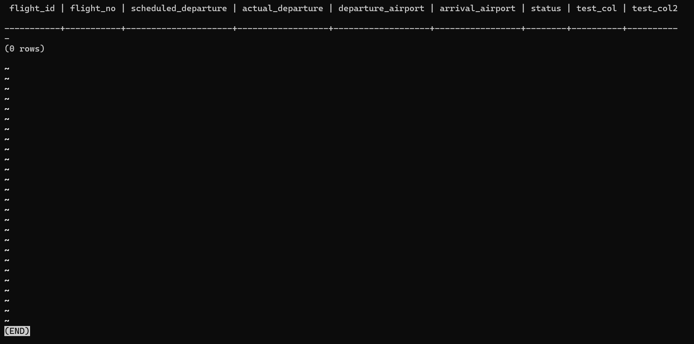
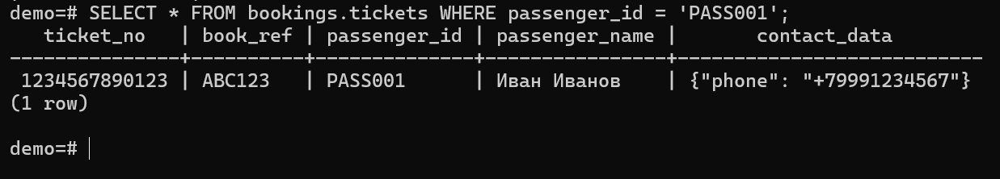

# Домашнее задание №6. Индексы в PostgreSQL

## 1. Исследование статистики (`pg_stats`)

**Скриншот статистики:**

**Анализ (на примере таблицы `flights`):**
1. `flight_id` — `n_distinct` = -1 (каждое значение уникально), `null_frac` = 0. Наибольшая кардинальность. Идеально подходит для начала составного индекса.
2. `status` — `n_distinct` = 3 (всего 3 статуса), `null_frac` = 0. Хорошая колонка для фильтрации, но из-за малого числа уникальных значений не подходит для начала индекса.
3. `actual_departure` — `n_distinct` = -1, но `null_frac` > 0 (есть пустые значения, так как рейсы могут быть отменены). Может использоваться в индексе, но нужно учитывать NULL.

## 2. Sargability (оптимизация предикатов)

**Неоптимизированный запрос (с функцией):**

**Оптимизированный запрос (с датами):**

**План после создания индекса:**

Объяснение:
В первом случае мы использовали функцию `EXTRACT(DOW...)`, из-за чего база не могла использовать индекс (нарушение Sargability). Во втором случае мы использовали явные даты, создали индекс `idx_flights_scheduled_status`, но база всё равно выбрала `Seq Scan`. Это связано с тем, что в нашей тестовой таблице всего 8 строк, и последовательное чтение для неё быстрее, чем использование индекса. На реальных больших таблицах этот индекс обязательно будет использоваться.

## 3. Частичные индексы (Partial Indexes)

Запрос:

План до индекса:

План после индекса:

Объяснение:
Частичный индекс создается только для подмножества строк (в этом случае для пассажиров с ID, начинающимся на 'PASS'). В отличие от обычного индекса B-Tree, который строится по всей таблице, частичный занимает меньше места на диске и быстрее обновляется. На больших таблицах это дает значительный прирост производительности.
